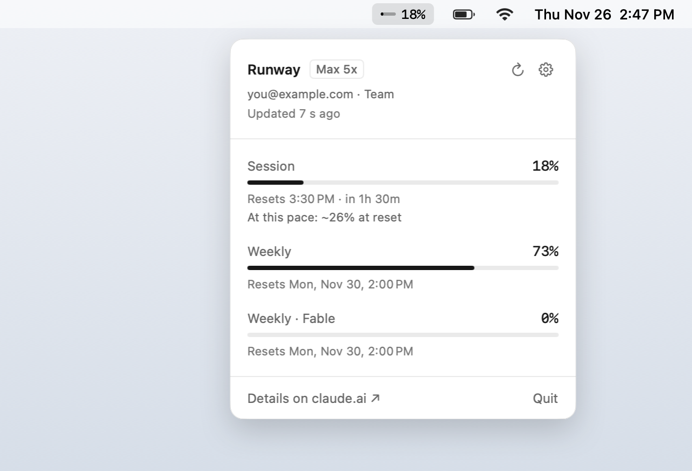

<div align="center">


# Runway

**Your Claude plan usage, always in the menu bar.**

See how much of your 5-hour session and weekly limit is left, at a glance, and get a heads-up before you hit the wall.

[](#requirements)
[](Package.swift)
[](https://github.com/Romainl01/runway/releases/latest)
[](LICENSE)

<picture>
  <source media="(prefers-color-scheme: dark)" srcset="docs/images/hero-dark.png">
  
</picture>

</div>

## Install

[Download Runway.dmg](https://github.com/Romainl01/runway/releases/latest/download/Runway.dmg) (signed and notarized), open it and drag Runway to Applications. Updates then arrive on their own.

Or from the terminal:

```sh
curl -fsSL https://raw.githubusercontent.com/Romainl01/runway/main/install.sh | bash
```

This downloads the latest release, puts `Runway.app` in `/Applications` (or `~/Applications`) and starts it. Runway checks for updates by itself (Sparkle), and Settings has a Check for Updates button.

## Features

- **Live usage in the menu bar**: a mini gauge and a number. Pick the 5-hour session, the weekly limit, both, or just the icon.
- **Every limit in one popover**: session, weekly, per-model weekly limits (e.g. Opus) and extra usage credits, with reset times and countdowns.
- **Pace projection**: "At this pace: ~41% at reset", or a warning when you are on track to hit 100% before the reset.
- **Threshold notifications** at 50, 80 and 95% (configurable, per limit), plus an optional "session refilled" notice. Each threshold fires once per window.
- **Calm by design**: monochrome, colour only when something needs your attention (amber from 80%, red from 95%). Follows light and dark mode.
- **English and French**, following your Mac's language.
- **Zero setup**: if Claude Code is logged in on your Mac, Runway just works. Personal, Team and Enterprise accounts are detected, and switching accounts in Claude Code is picked up on the next refresh.

## Requirements

- macOS 26 or later.
- [Claude Code](https://docs.claude.com/en/docs/claude-code) installed and logged in with a Claude subscription (Pro, Max, Team or Enterprise).

## How it works

Claude Code keeps its OAuth token in your login keychain. Runway reads it with `/usr/bin/security` (the tool Claude Code itself uses, so there is no keychain prompt), then asks Anthropic's usage endpoint for your current limits.

- **Your token stays with you.** It is only ever sent to `api.anthropic.com`, never stored, logged or displayed, and Runway never refreshes it. If it expires, open Claude Code and Runway picks up on its own.
- **Gentle on the API.** Runway refreshes every 3 to 5 minutes, when you open the popover, and when your Mac wakes up. Every request goes through a single gate: at least 60 s between calls, at most 20 calls an hour, and a server `Retry-After` is honored in full. The last values are cached, so a relaunch shows them instantly without calling again.
- **No account, no analytics, no third-party server.** Your account email and type come from Claude Code's local config (`~/.claude.json`).

## Usage

| | |
|---|---|
| **Menu bar** | Click the gauge to open the popover. |
| **Refresh** | The ↻ button. If a call was made less than a minute ago, the refresh is queued, not dropped. |
| **Settings** | The ⚙ button: what the menu bar shows, notification thresholds, session refill notice, launch at login. |
| **Quit** | `⌘Q` in the popover. |

### Troubleshooting

- **"Claude Code not detected"**: install Claude Code and run `claude` once to log in.
- **"Claude Code connection expired"**: open Claude Code; Runway resumes by itself.
- **"Call limit reached · back at 16:21"**: Anthropic is rate-limiting usage reads for your account. Runway waits until the time shown and does not retry earlier, since that would only extend the limit.

### Uninstall

Quit Runway, then:

```sh
rm -rf /Applications/Runway.app ~/Applications/Runway.app
defaults delete com.rocapine.runway
```

## Build from source

Requires Xcode 26 (Swift 6.2).

```sh
git clone https://github.com/Romainl01/runway.git && cd runway
swift test                  # core logic tests
./scripts/build-app.sh      # builds and signs build/Runway.app
open build/Runway.app
```

The app is ad-hoc signed unless you set `RUNWAY_SIGN_IDENTITY` to one of your codesigning identities.

<details>
<summary><b>QA mode: fixtures, scenarios and themes, without touching the network</b></summary>

```sh
APP=build/Runway.app/Contents/MacOS/Runway
RUNWAY_FIXTURE=Tests/Fixtures/usage-sample.json RUNWAY_NOW=2026-11-26T13:47:00Z $APP --preview-window
```

- `--preview-window`: shows the popover content in a regular window.
- `RUNWAY_FIXTURE=<json>`: replaces the network call and the keychain with a fixture.
- `RUNWAY_NOW=<ISO 8601>`: shifts the clock so the fixture's reset times stay in the future.
- `RUNWAY_THEME=system|light|dark|glass`: starting theme.
- `RUNWAY_SCENARIO=<id>`: shows a scenario at launch (`calm`, `warning`, `critical`, `creditsCap`, `overflow`, `personal`, `loading`, `offline`, `expired`, `claudeCodeMissing`).
- `RUNWAY_SCENARIO=mem-<id>`: same for the Memory tab (`mem-medium`, `mem-calm`, `mem-critical`, `mem-hover`, `mem-confirm`, `mem-stopping`, `mem-stopped`, `mem-busy`, `mem-loading`, `mem-overflow`).
- `RUNWAY_TAB=plan|memory`: opens on that tab.
- `RUNWAY_LIVE_MEMORY=1` (with a fixture): this Mac's real processes in the Memory tab, with a Stop that never signals anything.
- `RUNWAY_SCREEN=settings`: opens on the settings screen.
- `RUNWAY_OPEN_MENU=1`: opens the real menu bar panel after launch.
- `RUNWAY_DUMP_MENUBAR=<dir>`: exports sample menu bar labels as PNG.
- `RUNWAY_SNAPSHOT=<png>` (with `--preview-window`): writes the preview window's content as a PNG, then quits. No screen recording permission needed.
- `RUNWAY_DEBUG=1`: logs HTTP statuses to stderr (never the token).
- Append `-AppleLanguages '(fr)'` to see the French UI.

Right-click the popover header for the same themes and scenarios at runtime. A scenario is drawn over the live data; "Back to live data" or the refresh button leaves it.

</details>

### Project layout

- `Sources/RunwayCore`: everything testable, no UI (API client, keychain, call gate, polling, pace projection, notifications, formatting).
- `Sources/Runway`: the SwiftUI menu bar app (`Theme.swift` holds every design token).
- `Resources/Localizable.xcstrings`: English and French copy.

## Disclaimer

Runway is an independent project, not affiliated with or endorsed by Anthropic. It relies on the usage endpoint behind Claude's own usage page, which is undocumented and may change without notice. "Claude" and "Claude Code" are trademarks of Anthropic.

## License

[MIT](LICENSE) © Romain Lagrange
